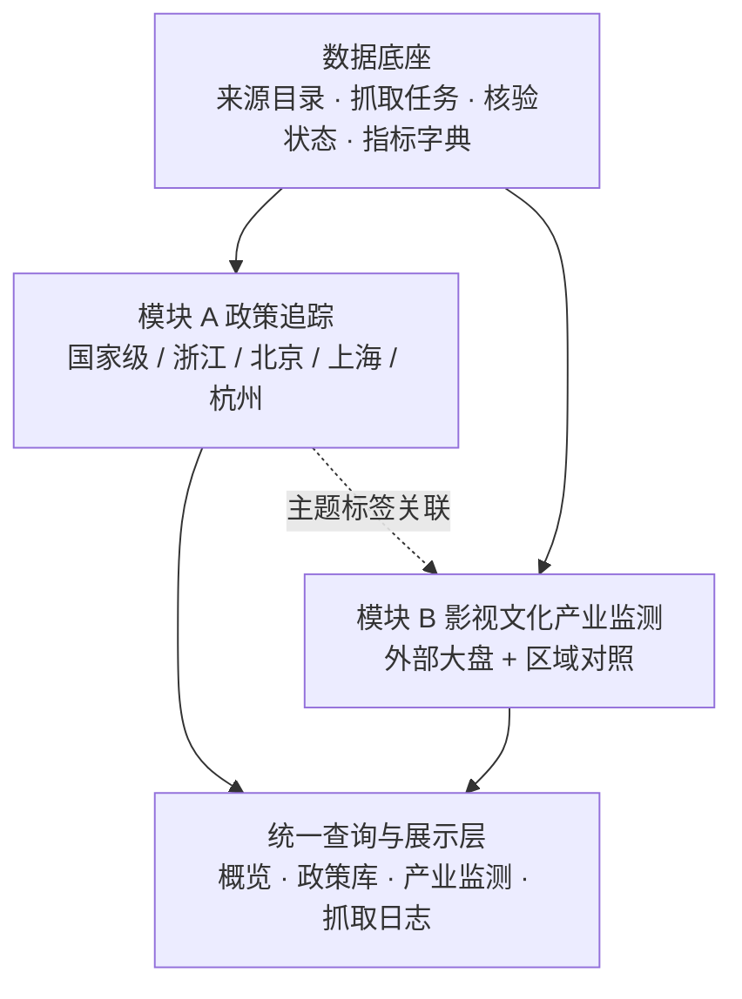
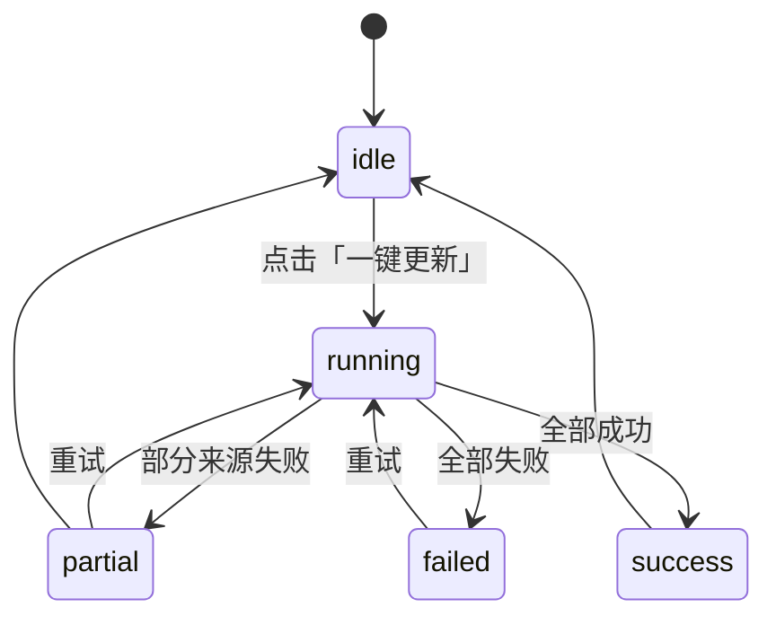
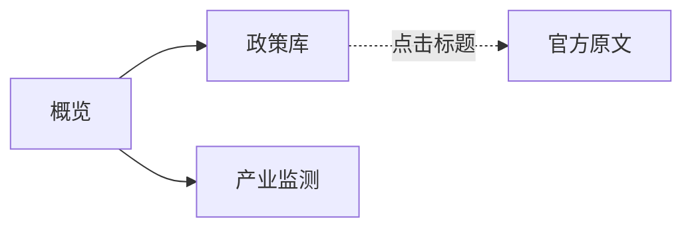

# 文化产业观察站｜第一期产品总方案

> 版本：V1.1（2026-10-19）
> 定位：覆盖「政策追踪」与「影视文化产业监测」两个模块的第一期产品总纲，规定模块关系、统一数据结构、指标字典、更新机制与页面交互。
> 本期变更：**移除空间文化数据库模块**；产业监测新增全国行业大盘指标（电影/院线、文旅/体验），概览页以大盘数据为主。
> 配套文档：[culture_industry_policy_spec 1019.md](./culture_industry_policy_spec%201019.md) —— 该文件继续作为**模块 A 政策追踪**的详细数据规范（字段、枚举、排序、去重、验收项），本文件不重复其细节。

---

## 一、产品定位与一期目标

### 1.1 一句话定位

一个面向研究与决策的文化产业观察工具：**用可核验的公开数据，回答「政策在支持什么」「产业大盘在往哪走」两个问题**，并把每个数字、每段摘要都指回官方来源。

### 1.2 一期目标（可交付、可演示、可持续更新）

| 目标 | 判断标准 |
|---|---|
| 政策可追踪 | 五个区域的政策可一键抓取入库，标题直接跳转官方原文 |
| 大盘可比较 | 电影/院线与文旅/体验两类指标并列展示，2025 与 2026 同期对照，口径与来源逐条注明 |
| 区域可对照 | 全国与浙江省、北京市、上海市、杭州市指标并列；无同口径数据时明确标「未获取」 |
| 跨端可查看 | 构建产物是单个 HTML，手机、平板、电脑均可打开，不依赖本地服务 |
| 更新可解释 | 每次构建都有抓取日志：抓了哪些来源、新增多少、失败在哪、耗时多久 |
| 边界可说明 | 测算值标注公式，非官方数据单独标记，未获取数据不用估算值填充 |

### 1.3 一期不做的事（成本与质量控制线）

- 不覆盖全国所有地级市政策，只做国家级、浙江省、北京市、上海市、杭州市。
- **不建设空间文化数据库**（公共文化设施、园区名录、空间运营数据均不在本期范围）。
- **不提供人工核验后台**：数据在本地抓取后构建为静态页面，站内不做审核与修改。
- **不建设二级页面**：点击政策标题直接打开官方原文。
- 不追求全量文化产业企业财务数据库。
- 不把无法公开验证的客流、收入、入驻率填成估算数据。
- 不在缺乏研究设计的情况下自动生成「某项政策提升了产业表现」的结论。
- 不把不同统计口径的指标合并成一个未经验证的综合评分。
- 不做申报倒计时、置顶提醒与项目申报管理。

---

## 二、模块架构与关系

### 2.1 模块划分



### 2.2 模块职责与依赖

| 模块 | 回答的问题 | 核心实体 | 依赖 |
|---|---|---|---|
| A 政策追踪 | 最近出台了哪些重点政策？支持谁、支持什么、怎么做？ | `policy_documents` | 来源目录、抓取任务 |
| B 产业监测 | 大盘在涨还是跌？电影与文旅各是什么走势？区域差异如何？ | `indicators` | 指标字典、统计来源 |
| D 数据底座 | 数据从哪来、什么时候更新、是否核验过？ | `data_sources`、`sync_runs` | 无 |

### 2.3 模块之间的连接方式

不使用「一个万能标签」连接模块，而用**可追溯的弱关联**：

1. **政策 → 指标**：政策主题标签（影视文化、文化消费等）与指标分组（电影/院线、文旅/体验）建立映射表；页面只做并列展示，不自动推断因果。
2. **政策 → 指标期间**：政策发布日期可与指标统计期对齐展示（时间轴），但不据此生成结论。
3. **所有关联**都必须能回到原始来源，且默认 `verified = false`，人工确认后才参与统计口径。

---

## 三、统一数据规范

### 3.1 三类数据必须分开

| 类型 | 定义 | 存放 | 示例 |
|---|---|---|---|
| 原始数据 | 官方统计值、政策原文、公开名录 | `indicators` 的原始值 / 政策快照 | 国庆档票房 11.65 亿元 |
| 标准化数据 | 统一行政区划、单位、时间口径后的数据 | 主表 | 统一为「亿元」「2026 国庆档」 |
| 研究指标 | 同比、日均、人均等计算结果 | 计算字段 | 人均花费 = 总花费 ÷ 总人次 |

**规则**：研究指标必须记录计算公式与输入数据版本，页面提供「口径」说明。

### 3.2 通用字段（所有实体共有）

| 字段 | 类型 | 说明 |
|---|---|---|
| `id` | string | 稳定主键，不使用标题 |
| `regionCode` | enum | `national` / `zhejiang` / `beijing` / `shanghai` / `hangzhou` |
| `sourceId` / `sourceName` | string | 来源标识与显示名 |
| `sourceUrl` | string | 官方原始页面 URL |
| `collectedAt` | ISO datetime | 采集时间，**不得替代发布日期或统计期** |
| `lastCheckedAt` | ISO datetime | 最近一次核验来源的时间 |
| `dataStatus` | enum | `draft` / `reported` / `verified` / `stale` / `missing` |
| `isMock` | boolean | 示例数据必须为 `true` |

### 3.3 区域与层级

| regionCode | 显示名 | 说明 |
|---|---|---|
| `national` | 全国 / 国家级 | 中央层面发布，或全国口径统计 |
| `zhejiang` | 浙江省 | 浙江省级政策与全省统计 |
| `beijing` | 北京市 | 北京市级 |
| `shanghai` | 上海市 | 上海市级 |
| `hangzhou` | 杭州市 | 杭州市级 |

> 浙江省与杭州市是包含关系。展示时不得把「浙江省级」与「杭州市级」相加当作全省总量；涉及汇总时必须在口径中说明。

### 3.4 时间与单位

- 日期统一 `YYYY-MM-DD`；时间戳统一 ISO 8601，业务日期按 `Asia/Shanghai` 计算。
- 金额统一「亿元」或「万元」并在字段中声明；不得在同一列混用单位。
- 比率字段单独存放（`yoy`），并记录是名义增速还是实际增速。
- **统计期必须显式记录**（如「2025 国庆档（8 天）」），不能只写年份。

### 3.5 状态字段的职责边界

| 维度 | 字段 | 取值 |
|---|---|---|
| 政策法律状态 | `policyStatus` | `in_force` / `consultation` / `upcoming` / `expired` / `repealed` / `superseded` / `unknown` |
| 摘要核验 | `summaryReviewStatus` | `draft` / `pending` / `verified` / `rejected` |
| 记录核验 | `verificationStatus` | `pending` / `verified` / `needs_review` / `source_error` |
| 指标数据状态 | `dataStatus` | `draft` / `reported` / `verified` / `stale` / `missing` |
| 前台可见性 | `visibilityStatus` | `published` / `hidden` / `archived` |
| 页面请求状态 | 前端临时状态 | `loading` / `success` / `empty` / `error` |

**一期关键约束**：`unknown` 不等于失效；采集时间不等于发布日期；`draft` 摘要不得显示为已核验；`missing` 不得渲染为 0。

---

## 四、模块 A：文化政策追踪

### 4.1 范围

| 项目 | 一期设定 |
|---|---|
| 区域 | 国家级、浙江省、北京市、上海市、杭州市 |
| 关注对象 | **重点政策摘要同步**为主；申报、公示类保留记录但不设提醒 |
| 排序 | 重点政策优先，其余按发布日期倒序 |
| 数据来源 | 一键抓取官方栏目，入库后摘要标记待核验 |

### 4.2 重点政策判定（可解释规则）

满足任一条件即标记 `isKeyPolicy = true`，并记录命中的规则编号：

| 规则 | 条件 |
|---|---|
| R1 | 国家级，且文件类型为规划、行动方案、产业扶持、实施细则 |
| R2 | 标题命中「规划 / 行动方案 / 实施方案 / 指导意见 / 实施意见 / 若干措施 / 管理办法 / 实施细则 / 支持政策」 |
| R3 | 标题命中「专项资金 / 扶持 / 奖励 / 补贴」 |

**排除项**：申报指南、征求意见、公示、批复、评估结果、遴选、职称、采购类文件不作为重点政策，即使标题含上述关键词。

不因标题包含「重磅」「重大」等宣传词判定为重点政策。

### 4.3 抓取与入库

```text
读取来源目录（仅启用项）
  → 请求栏目页（超时、重试、限速、UA 标识）
  → 解析候选链接（标题 + URL + 日期线索）
  → 关键词过滤（文化产业相关）+ 新闻/公告排除
  → 只取列表中最新的 N 条（避免反复抓取历史旧文）
  → 去重（URL 规范化 / 文号+机构 / 标题+日期）
  → 抓取详情页（文号、机构、正文、发布日期）
  → 生成摘要草稿（抽取式，标记 pending）
  → 生成主题与工具标签（关键词规则，标记待核验）
  → 写入 policies.json，记录 sync_run
```

**失败处理**：单个来源失败不影响其他来源；已有数据不被覆盖；来源状态记为 `source_error`，页面显示「来源暂时无法同步」。

### 4.4 详细字段与枚举

见配套规范文档第 3–11 节。

---

## 五、模块 B：影视文化产业监测

### 5.1 范围

- 以**全国外部大盘**为主体，建立「电影/院线（票务型消费）」与「文旅/体验型消费」两类指标。
- 区域对照：全国、浙江省、北京市、上海市、杭州市；仅在存在同口径公开数据时展示，否则标「未获取」。
- 数据底层遵循国家统计局《文化及相关产业分类（2018）》作为行业映射起点。

### 5.2 必须区分的三个层次

| 层次 | 指标示例 | 含义 |
|---|---|---|
| 市场消费 | 电影票房、观影人次、出游人次、人均花费 | 需求端规模 |
| 内容供给 | 故事影片产量、银幕数 | 供给端产出 |
| 企业经营 | 文化企业营业收入、利润 | 主体经营结果 |

**口径提示**：国家统计局「文化及相关产业营业收入」范围远大于影视行业；「内容创作生产」也不等于影视产业。这类数值只能作为**宏观背景指标**，不得标注为「影视产业营收」。

### 5.3 指标字典（一期）

#### 1.1 电影 / 院线类（票务型消费）

| code | 指标 | 单位 | 2025 | 2026 | 同比 | 口径 / 来源 | 看板 |
|---|---|---|---|---|---|---|---|
| `CN_BOX_OFFICE` | 全国电影票房 | 亿元 | 18.35 | 11.65 | -36.51% | 国庆档总口径；2025 年 8 天、2026 年 7 天，天数不同，总量不可直接比较。国家电影局 | 卡片 |
| `CN_BOX_OFFICE_DAILY` | 全国日均票房 | 亿元/日 | 2.2938 | 1.6643 | -27.44% | 日均可比：总票房 ÷ 档期天数。测算值 | 卡片 |
| `CN_ADMISSIONS` | 全国观影人次 | 万人次 | 5,007 | 3,199.59 | -36.10% | 国庆档总口径。国家电影局 | 卡片 |
| `CN_ADMISSIONS_DAILY` | 全国日均观影人次 | 万人次/日 | 625.88 | 457.08 | -26.97% | 总人次 ÷ 档期天数。测算值 | 卡片 |
| `CN_AVG_TICKET` | 全国平均票价 | 元/张 | 36.69 | 36.41 | -0.76% | 票房 ÷ 人次；2025 年为媒体推算值 | 卡片 |
| `CN_SCREENS` | 全国银幕总数 | 块 | 93,187（2025 末） | 95,819（2026.9 末） | +2.82% | 期末存量。国家电影局 | 趋势 |
| `CN_SCREEN_NET` | 全国银幕净增 | 块 | — | 2,632（9 个月） | — | 期间增量。国家电影局 | 明细 |
| `CN_SCREEN_OUTPUT` | 全国单银幕年产出 | 万元/年 | 79.80 | 未披露 | — | 年度票房 ÷ 银幕数。媒体测算，标注「参考」 | 明细 |
| `CN_NON_TICKET_SHARE` | 行业非票收入占比 | % | 20%–25% 区间 | — | — | 媒体/券商测算，仅展示区间 | 区间条 |

#### 1.2 文旅 / 体验型消费类

| code | 指标 | 单位 | 2025 | 2026 | 同比 | 口径 / 来源 | 看板 |
|---|---|---|---|---|---|---|---|
| `CN_TRAVEL_TRIPS` | 全国国内出游人次 | 亿人次 | — | — | +6.30% | 日均可比口径。文化和旅游部 | 卡片 |
| `CN_TRAVEL_SPEND` | 全国国内出游总花费 | 亿元 | — | — | +4.30% | 日均可比口径。文化和旅游部 | 卡片 |
| `CN_TRAVEL_PER_CAPITA` | 全国文旅人均花费 | 元/人次 | 911.04 | 893.92 | -1.88% | 出游总花费 ÷ 出游人次（测算值） | 核心对比卡 |
| `CN_NIGHT_DISTRICT_TRAFFIC` | 国家级夜间文旅集聚区客流 | 增速 % | — | — | +5.60% | 国庆假期。文化和旅游部 | 明细 |
| `CN_TOUR_ENT_SALES` | 旅游游览和娱乐服务销售收入 | 增速 % | — | — | +23.60% | 增值税发票口径。税务总局 | 明细 |
| `CN_PARK_SALES` | 游乐园销售收入 | 增速 % | — | — | +41.20% | 增值税发票口径。税务总局 | 明细 |
| `CN_MAJOR_SHOWS` | 全国大型演出场次 | 场 | — | 180（演唱会 125 + 音乐节 55） | — | 文化和旅游部 | 卡片 |

#### 1.3 文化产业背景与区域对照

| code | 指标 | 单位 | 期间 | 数值 | 同比 | 说明 |
|---|---|---|---|---|---|---|
| `CN_CULTURE_REV` | 规模以上文化及相关产业企业营业收入 | 亿元 | 2025 年度 | 152,135 | +7.4% | 宏观背景，非影视行业营收 |
| `CN_CONTENT_PROD_REV` | 内容创作生产营业收入 | 亿元 | 2025 年度 | 34,991 | +13.5% | 大类口径，含出版、广播影视、演艺 |
| `CN_BOX_OFFICE_ANNUAL` | 全国电影票房（全年） | 亿元 | 2025 年度 | 518.32 | — | 与「国庆档票房」不是同一口径 |
| `ZJ_CULTURE_REV` | 浙江省文化及相关产业营业收入 | 亿元 | 2025 年度 | 未获取 | — | 需核实规模以上口径 |
| `ZJ_BOX_OFFICE` | 浙江省电影票房 | 亿元 | 2025 年度 | 未获取 | — | 部分城市数据须标注「部分地区样本」 |
| `ZJ_FILM_ENTERPRISE` | 浙江省影视企业数量 | 家 | 2025 年度 | 未获取 | — | 需统一企业识别与去重规则 |
| `BJ_BOX_OFFICE` | 北京市电影票房 | 亿元 | 2025 年度 | 未获取 | — | 城市口径 |
| `SH_BOX_OFFICE` | 上海市电影票房 | 亿元 | 2025 年度 | 未获取 | — | 城市口径 |
| `HZ_BOX_OFFICE` | 杭州市电影票房 | 亿元 | 2025 年度 | 未获取 | — | 城市口径 |

> `dataStatus`：`reported` 已录入待复核 / `verified` 已核验 / `missing` 未获取。**未获取一律留空，不插补、不推算。**

### 5.4 数据来源与优先级

在「数据来源」字段中标注以下等级，避免混淆：

| 指标 | 来源机构 | 发布形式 | 优先级 |
|---|---|---|---|
| 国内出游人次 / 总花费 | 文化和旅游部 | 官网正式发布 | 官方 |
| 跨区域人员流动量 | 交通运输部 | 最终发布（非预计值） | 官方 |
| 铁路 / 民航客运量 | 国铁集团 / 交通运输部 | 最终发布 | 官方 |
| 出入境 | 国家移民管理局 | 官网正式发布 | 官方 |
| 国庆档票房 / 人次 | 国家电影局 | 官网正式发布 | 官方 |
| 人均花费 | （测算） | 总花费 ÷ 总人次 | 测算值，标注公式 |

页面把来源等级渲染为三档：**官方** / **测算值** / **非官方**。非官方数据不得与官方数据使用相同样式。

### 5.5 展示规则

- **总量与日均分开呈现**。假期天数不同的年份，总量同比会放大或缩小降幅，必须同时给出日均可比口径。
- 只比较同口径、同期间的数据；口径不同则分行展示并标注。
- 区间数据（如非票收入占比）只展示区间，不换算成单一数值。
- 绝对值缺失但增速存在时，卡片主值显示增速并标注「同比增速」，不伪造绝对值。
- 页面提供「数据缺口」视图：列出 `missing` 指标及获取途径，作为下一期采集任务清单。

### 5.5.1 趋势线只画可比的东西

同一指标的历史期间长度不一致时（如累计营收的一季度 / 上半年 / 全年，或不同天数的假期），不能把绝对值连成一条线。因此增加 `trendBasis`：

| 取值 | 含义 |
|---|---|
| `value` | 直接连绝对值（如银幕总数这类期末存量） |
| `yoy` | 连同比增速（累计口径指标的标准做法） |
| `none` | 不连线，只列出已收录期间，并说明口径不同 |

这条规则的作用是防止「一条看起来很专业的曲线」隐含一个错误的可比性假设。


### 5.6 推荐研究问题（页面只提问，不自动下结论）

- 日均票房与日均人次降幅是否一致？票价因素影响多大？
- 文旅人均花费下降，是消费降级还是客群结构变化？
- 银幕仍在增长而单银幕产出下降，行业进入什么阶段？
- 政策密集期与大盘指标变化在时间上是否同步？
- 哪些指标持续缺失，需要专项调研或采购数据？

### 5.7 时间口径：数据期、发布日期、预计下次发布

一期不追求「所有指标同一频率」，而是让每张卡片都回答三个问题：数据是哪一段的、什么时候发布的、下一次大概什么时候发布。因此每条指标固定携带：

| 字段 | 含义 | 缺失时页面的表现 |
|---|---|---|
| `period` | 数据期（`2026 国庆档` / `2026-09` / `2026 Q2` / `2025 年度`） | 显示「数据期未标注」 |
| `publishedAt` | 官方发布日期 | 显示「发布日期未记录」 |
| `nextRelease` | 预计下次发布日期，只填有明确节奏的指标 | 显示「发布节奏不固定」 |
| `history` | 历史序列，≥3 期才画趋势线 | 进入「数据缺口 → 趋势序列待补齐」 |

新鲜度由 `publishedAt` 推导，不在数据里硬编码：

- ≤ 30 天：数据较新
- 31–60 天：可用
- > 60 天：待更新

这样「国庆档数据」只是众多数据期中的一个，页面不会因为过了档期就失去意义；任何一条指标的更新时间都可以被单独审视。

### 5.8 指标采集：M2 半自动闭环

官方指标多以 PDF、带表格的网页或新闻稿形式发布，直接正则抽取极易把数字和单位对错（例如把「3.4 亿人次」误读成 3.4 万人次）。一期采用「机器找候选 + 人工确认」：


候选行必须包含：指标代码、期间、数值、单位、同比、发布日期、来源名称、原文链接、原文句子。原文句子是硬性要求——没有原句就无法判断数字归属，该候选不得采纳。

抽取规则不是「句子里找任意数字」，而是「按指标关键词就近锚定 + 单位换算」：先定位同一句中的指标锚点词（如「票房」「银幕」「人次」），再在其邻近位置取带单位的数字，并强制单位与指标类型匹配。另有三条排除规则：

- 累计口径词（截至 / 累计 / 全年 / 总票房）出现在数字前 30 个字内，丢弃该候选；
- 一篇文章只对应一个期间，句中期间与标题期间不一致时视为同比对照句，跳过；
- 同一指标同一期间只保留一条候选，避免同期间出现两个数值。

一期的采集来源：

| 来源 | 覆盖内容 | 翻页 |
|---|---|---|
| 国家电影局 · 工作动态 / 行业资讯 | 档期票房、观影人次、银幕数 | 最新 12 条 |
| 文化和旅游部 · 要闻信息 | 各假期出游人次、总花费、大型演出 | 8 页，覆盖春节至国庆 |
| 国家统计局 · 最新发布 | 文化及相关产业营收、内容创作生产、文化新业态 | 36 页，覆盖 2023 年度至今 |

### 5.9 第三方数据的使用边界

当官方口径缺失时，可以引入第三方数据补充观察，但必须满足三条：

1. 来源名称与来源等级同时标注，第三方一律标为「非官方」；
2. 与官方指标使用不同样式，不参与官方指标排序或加总；
3. 第三方数据不得回填官方指标的缺失值，只能作为独立指标行存在。

一期尝试过的第三方通道（猫眼票务接口 403、灯塔接口返回 SPA 外壳、中国电影数据信息网为 Vue 单页）均无法稳定取数，因此暂不接入任何第三方数值；`sourceLevel` 保留「非官方」档位，等有稳定可核验的入口再启用。

### 5.10 地方票房：为什么不直接填

分地区票房是本期最典型的「看起来该有、实际上没有」的数据。实际情况是：

| 通道 | 结果 |
|---|---|
| 省级 / 市级电影局独立数据栏目 | 不存在，多数地方电影管理职能并入宣传部或文旅局 |
| 北京市政府站内搜索 | 结果页由 JS 异步加载，静态抓不到 |
| 杭州 / 浙江省文旅厅栏目 | 有文章，但没有票房类内容 |
| 猫眼、灯塔等第三方接口 | 403 或 SPA 外壳 |

因此一期不填任何地方票房数值，改为两条通道：

1. **自动扫描**：把 4 个地方官方栏目登记为来源，出现「<地区>…票房…亿元」的句子即产出候选，走人工确认流程；
2. **人工补录**：`data/region-manual.csv` 一行一个地区一个期间，强制要求填写来源链接，`npm run import:regional` 写入指标库。

这两条通道都保证「有数必有源」。页面在无数据时显示「未获取」，并在数据缺口区列出获取途径，而不是给一个无法追溯的估算值。

### 5.11 文博周报：用官方周更内容填补「周频」空缺

影视与文旅指标最快只到假期或季度，中间存在观察空档。国家文物局每周发布的「一周文物动态摘编」正好补上这一层，但它**不是统计数据**，因此作为独立模块处理，不与指标卡混排。

三类内容与各自的口径：

| 内容 | 来源 | 频率 | 性质 |
|---|---|---|---|
| 周报要点 | 国家文物局「一周文物动态摘编」 | 周 | 动态汇编：地区 + 标题 + 首段摘要 + 原文链接 |
| 展讯名录 | 国家文物局「看展览｜博物馆展讯速览」 | 月 | 名录：博物馆 / 展览 / 地点 / 时间 / 简介 |
| 博物馆客流 | 国家文物局新闻稿 | 假期、暑期 | 数值：全国接待观众 + 同比 + 日均同比 |
| 年度底数 | 文旅部《文化和旅游发展统计公报》 | 年 | 年末口径：备案博物馆数、接待观众、陈列展览 |

为什么单独存放（`data/heritage.json`）而不并入指标库：指标库的每条记录都要求「单一数值 + 可比口径 + 趋势序列」，而周报是多条目文本、展讯是多行名录。硬塞进去会让指标模型变成混合容器，之后每一次查询都要判断类型。

三条边界：

1. 周报条目只呈现要点与原文链接，不统计条数、不按地区聚合，避免把「主管部门工作动态数量」误读成「地区产业活跃度」；
2. 客流各假期天数不同，总量不可直接比较，页面单独给出「日均同比」列，只在官方给出日均口径时才可跨年对照；
3. 文创销售额没有官方时序发布（只有活动期的第三方平台披露），因此不作为数值指标进入看板，只可能在周报条目里作为事件出现。

采集实现有三个必须处理的站点特征：只支持 http、列表为 CDATA + 单引号链接、分页走 `dataproxy.jsp` 独立接口。采集分两阶段（先扫列表挑候选，再抓需要的详情），并把结果与已有归档合并，保证反复运行不会丢掉历史期次。

---

## 六、更新机制

### 6.1 两级更新

| 层级 | 触发 | 内容 |
|---|---|---|
| 手动一键更新 | 页面按钮 / `npm run build` | 立即抓取所有启用来源，生成同步日志 |
| 定时更新 | 本地计划任务 | 建议每日一次政策扫描；指标按月人工确认候选 |
| 指标半自动 | `npm run collect:indicators` + `npm run promote:indicators` | 抓候选 → 人工 accept → 合并进指标库 |

政策可以全自动入库（有原文链接，可回溯）；指标必须经过人工确认（数值与单位容易错配，且需要判断口径）。两者的自动化程度不同，不能合并成同一个流程。

### 6.2 同步流程与状态机



### 6.3 执行规则

- 单来源超时 15 秒，失败重试 2 次，指数退避。
- 请求间隔 ≥ 0.9 秒，遵守目标站点 robots 与合理访问频率。
- 单来源每次只处理列表中最新的 8 条，避免对目标站点造成压力。
- 任一来源失败不清空既有数据。
- 只有成功解析后才更新「最后成功同步时间」。
- 每次运行写入 `sync_runs`：开始/结束时间、来源新增/重复/失败数、错误摘要、耗时。

### 6.4 复核节奏

- 每日：自动发现新政策（`dataStatus = draft`）。
- 每周：处理重复记录、核对摘要、补齐标签。
- 每月：核对指标口径与来源可访问性；检查政策有效性、后续实施细则、修订与废止。

---

## 七、页面交互

### 7.1 信息架构



一期只有三个页面，**不设二级页面**。政策条目的标题即外链，点击在新标签页打开官方原文。

### 7.2 全局元素

- 顶部：品牌、导航、数据更新时间。
- 不提供站内「一键更新」按钮：数据由本地构建生成，页面是静态产物。

### 7.3 概览页

按「先背景、后消费、再细分行业」的顺序排列，三组卡片固定这个顺序：

| 顺序 | 分组 | 卡片内容 |
|---|---|---|
| 1 | 文化产业背景 · 国家统计局 | 文化及相关产业营收、内容创作生产营收、文化新业态营收 |
| 2 | 文旅 / 体验型消费 · 外部大盘 | 出游人次、出游总花费、人均花费、大型演出场次 |
| 3 | 电影 / 院线 · 外部大盘 | 档期票房、暑期档票房、档期观影人次、平均票价 |

- 累计口径指标（文化产业背景组）趋势线一律用同比增速，卡片下方注明。
- 每张卡片固定展示：最新值 + 同比 + 数据期 + 发布日期 + 预计下次发布 + 新鲜度标签；有 ≥3 期序列的画迷你趋势线并注明口径（数值 / 同比增速）。
- 数据状态条：指标总数、官方来源数、未获取数、待更新数、政策名录条数。
- 重点政策动态：最近 6 条重点政策，点击直接打开原文。
- 不设「政策区域分布」「模块状态」卡片：这两个区块无法跨端复用，且信息已在政策库与数据状态条中体现。
- 页头只保留标题与构建时间，不加说明性长句：口径信息就地写在卡片和分组注释上，重复的总述反而会掩盖差异。

### 7.4 政策库（名录）

- 筛选：关键词、区域（含浙江省）、主题、类型、仅看重点政策。
- 表格列：标题（含外链）、区域、发布机构 / 文号、发布日期、类型、来源栏目。
- 排序：重点政策优先 + 发布日期倒序。
- **只展示前 60 条**，不提供分页；需要更多时用筛选缩小范围。
- 支持导出当前筛选结果为 CSV。
- 不提供站内详情页、不提供核验按钮。

### 7.5 产业监测

- 地区切换：全国 / 浙江省 / 北京市 / 上海市 / 杭州市。
- 全国视图的区块顺序与概览一致：
  1. 重点数据提示（卡片）
  2. 1.1 文化产业背景
  3. 1.2 文旅 / 体验型消费
  4. 1.3 文博周报（周报要点 / 客流 / 年度底数 / 展讯）
  5. 1.4 电影 / 院线（票务型消费）
  6. 数据来源与优先级
  7. 数据缺口
- 表格列：指标、最新值、单位、数据期、同比、口径 / 计算方式、来源、发布 / 下次、等级。
- 缺失值显示「未获取」并在缺口区列出获取途径。
- 「重点数据提示」的规则见 7.5.1。

### 7.5.1 重点数据提示卡片

这张卡片的作用是把「哪一项变了」直接摆到最前面，并给出下一步该看什么，避免用户在一张 25 行的表里自己找异常。

生成规则：

1. 筛出 `yoy` 绝对值 ≥ 5% 且状态不为 `missing` 的指标，按变动幅度降序取前 4 项；
2. 每项包含三段：
   - **观察到的事实**：指标名 + 涨降幅度 + 数据期 + 来源，例如「全国档期观影人次 下降 36.10%（2026 年国庆档，国家电影局）」；
   - **建议同时关注**：2–4 个关联指标，用来判断变化来自量还是价、总量还是日均；
   - **可能原因（待逐条验证）**：3–4 条候选解释，例如档期天数差异、平均票价、片单供给、替代性文化消费；
3. 关联指标与原因按指标代码登记在 `INSIGHT_META` 中，新指标未登记时退回通用提示；
4. 卡片底部固定两条声明：观察不构成因果结论；未获取指标数与测算/非官方指标数。

这里刻意不做的事：

- 不生成「某项政策导致某项指标变化」的表述；
- 不给变化打分或排序成「风险等级」；
- 不把不同口径的指标合成一个指数。

阈值 5% 是经验值，可在 `INSIGHT_THRESHOLD` 调整。它的意义只是「值得看一眼」，不代表统计显著或业务重要。

### 7.6 数据更新方式

- 本地运行构建脚本抓取并生成新的 `dist/index.html`，替换文件即完成更新。
- 抓取日志写入 `data/sync-runs.json`，供本地排查，不在页面展示。

---

## 八、技术实现（一期）

### 8.1 组成

| 组件 | 说明 |
|---|---|
| `server/build.js` | 构建入口：抓取（可选）→ 生成 `dist/index.html` |
| `server/serve.js` | 预览服务：把 `dist` 共享到局域网 |
| `server/sync.js` | 抓取流程：列表 → 过滤 → 去重 → 详情 → 入库 |
| `server/sources.js` | 官方来源目录 |
| `server/extract.js` | 列表解析、日期识别、正文抽取、摘要草稿 |
| `server/classify.js` | 主题/工具标签、文件类型、重点政策规则 |
| `server/store.js` | JSON 持久化、去重合并、同步日志 |
| `server/seed.js` | 首次启动的政策与指标种子数据 |
| `web/template.html` | 页面模板，构建时注入数据 |
| `dist/index.html` | 最终产物：单文件、数据内嵌 |
| `data/*.json` | 政策、指标、运行日志 |

### 8.2 为什么先构建再发布

浏览器直接抓取政府站点会被跨域策略拦截；同时「跨端查看」要求页面不依赖本地进程。因此把抓取放在本地脚本里，构建出的静态文件可以在任何环境打开：

- 本机双击 `dist/index.html`；
- 同一 Wi-Fi 下用 `start.bat` 起预览服务，手机访问 `http://<电脑IP>:8787`；
- 上传到任意静态托管供远程查看。

页面本身不含任何 API 调用，**不依赖第三方服务，不上传数据**。

### 8.3 运行方式

```bash
node server/build.js            # 抓取并构建
node server/build.js --no-sync  # 只重新构建
node server/serve.js            # 局域网预览
```

或双击 `update.bat`（抓取并构建）、`start.bat`（构建后预览）。

---

## 九、验收标准（一期）

- [ ] 五个区域的政策都能在政策库中筛选出来。
- [ ] 构建脚本能抓取至少 5 个来源，并记录新增/失败明细。
- [ ] 抓取失败不会清空既有数据，失败来源记录在日志中。
- [ ] 每条政策都有官方原文 URL，点击标题在新标签页打开。
- [ ] 政策库只展示第一页（前 60 条），不提供分页与站内详情。
- [ ] 页面无人工核验入口、无同步按钮，任何数据修改都需重新构建。
- [ ] 重复记录不会在名录中出现两次。
- [ ] 概览页展示电影与文旅两组大盘卡片，且每张卡片标注来源等级。
- [ ] 总量指标与日均指标分开展示，天数差异在口径中说明。
- [ ] 测算值标注公式，非官方数据使用不同样式。
- [ ] 未获取指标显示「—」并列入数据缺口，不显示为 0。
- [ ] 采集时间、发布日期、统计期三者独立。
- [ ] 页面不包含空间文化数据库入口。
- [ ] 构建产物为单个 HTML 文件，手机、平板、电脑均可打开。

---
## 十、数据来源清单（一期）

| 区域 | 来源 | 栏目 | 采集方式 | 频率 |
|---|---|---|---|---|
| CN | 中国政府网 | `/zhengce/` 政策发布 | HTML | 每日 |
| CN | 文化和旅游部 | `zwgk.mct.gov.cn/zfxxgkml/zcfg/` 政策法规 | HTML | 每日 |
| ZJ | 浙江省人民政府 | `col/col1544911` 法规文件 | HTML | 每日 |
| ZJ | 浙江省文化广电和旅游厅 | 门户首页公告区 | HTML | 每日 |
| BJ | 首都之窗 | `/zhengce/zhengcefagui/` 政策文件（含 9 页历史分页） | HTML | 每日 |
| SH | 上海市文化和旅游局 | `/zcfg/` 政策法规 | HTML | 每日 |
| HZ | 杭州市文化广电旅游局 | 门户文章（政策、公示、资金） | HTML | 每日 |

**指标来源**：国家电影局、文化和旅游部、国家税务总局、国家统计局、交通运输部、国家移民管理局。指标本期以人工录入为主，不自动抓取统计公报数值。

**文博来源**（独立归档 `data/heritage.json`）：

| 用途 | 来源 | 栏目 | 频率 |
|---|---|---|---|
| 周报要点 | 国家文物局 | 「一周文物动态摘编」（列表接口 `dataproxy.jsp?columnid=722`） | 周 |
| 展讯名录 | 国家文物局 | 「看展览｜博物馆展讯速览」 | 月 |
| 博物馆客流 | 国家文物局 | 文物新闻中的假期 / 暑期发布 | 每年数个假期 |
| 年度底数 | 文化和旅游部 | 《文化和旅游发展统计公报》 | 年 |

国家文物局站点仅 http 可访问、列表为 CDATA + 单引号链接、分页走独立接口，采集器已按这些特征适配，并在失败时保留已有归档。

**稳定性说明**：杭州市政府门户政策文件栏目、上海市文旅局部分栏目由 JavaScript 动态渲染，服务端无法直接取得列表，当前采用可静态访问的栏目替代，并在日志中标注覆盖范围，不伪造数据。

---

## 十一、风险与后续路线

| 风险 | 影响 | 应对 |
|---|---|---|
| 站点改版 | 解析失败 | 适配器隔离，单源失败不影响整体；每月复核 |
| 反爬限制 | 无法自动抓取 | 降级为人工录入 / 官方开放数据；不绕过访问控制 |
| 摘要质量 | 误读政策 | 只做抽取式草稿，关键字段保留原文定位，人工核验后发布 |
| 口径混淆 | 结论错误 | 指标字典强制记录口径与统计期；缺失不推算 |
| 数据量增长 | JSON 性能下降 | 二期迁移 SQLite / PostgreSQL，API 契约不变 |

**二期候选**：指标自动入库与校验、定时任务与增量抓取、环比/趋势图表、导出与订阅、管理端权限与审核流。

---

## 附录 A：政策主题与工具标签

**主题标签**：影视文化、空间文化、文化数字化、文化消费、产业要素、产业治理、公共文化、文化遗产。

> 注：空间文化作为**政策主题标签**保留（政策可能涉及园区、场馆、街区），但不再对应独立的空间数据库模块。

**政策工具标签**：财政支持、税费与金融、空间与设施、人才与创新、市场培育、监管与制度、公共服务、项目遴选。

## 附录 B：指标口径写法约定

每条指标必须写清五件事：

1. **统计对象**：规模以上企业 / 全部企业 / 档期总量 / 项目数。
2. **统计期**：年度、季度、假期；是否为累计值；假期天数。
3. **价格口径**：名义值还是实际值。
4. **地域口径**：全国、全省、全市；是否含区县。
5. **计算方式**：直接发布，还是由哪些字段计算得出。

缺任一项，标记为 `reported` 而非 `verified`。
